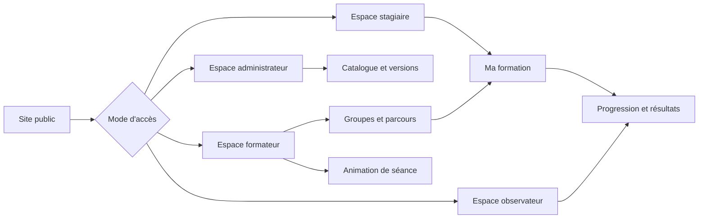

# 03 — App Flow (parcours dans l'application)

**But :** décrire les étapes vécues par les utilisateurs, y compris les décisions et les erreurs.\
**À ne pas confondre avec :** une maquette UI ou la liste technique des routes.

## Convention

Chaque flow précise : déclencheur, préconditions, parcours nominal, variantes, erreurs, état final, données modifiées et mesure de succès.

## Carte générale

## `FLOW-001` — Première entrée d'un stagiaire

**Préconditions :** compte actif, code valide, rattachement autorisé.

1. Le stagiaire ouvre le point d'entrée communiqué.
2. Il saisit son code d'accès.
3. Le système vérifie le code, le statut et les limites de tentative.
4. Si un changement initial de mot de passe est requis, il le réalise dans un écran dédié.
5. Il arrive sur « Ma formation » et voit une action principale explicite.
6. Il ouvre ou reprend la prochaine activité disponible.

**Erreurs à concevoir :** code invalide, compte inactif, trop de tentatives, aucun groupe, aucun contenu publié, session expirée. Chaque message doit expliquer la prochaine action sans révéler l'existence d'un compte.

**Succès :** le stagiaire atteint la première activité sans aide et sait comment continuer.

## `FLOW-002` — Préparer et affecter une formation

1. Le formateur choisit un contenu du catalogue ou une création personnelle.
2. Il consulte l'origine et la version avant de copier ou modifier.
3. Il structure chapitres et leçons, ajoute les contenus, puis prévisualise.
4. Il choisit un ou plusieurs groupes autorisés.
5. Il confirme l'affectation et voit son résultat.
6. Les stagiaires concernés voient le contenu selon les règles de visibilité.

**Décisions :** copier ou utiliser la version officielle ; brouillon ou contenu disponible ; groupe éligible ou non.\
**Erreurs :** sauvegarde partielle, média rejeté, conflit de version, groupe hors périmètre, contenu incomplet.

## `FLOW-003` — Suivre une leçon et enregistrer la progression

1. Le stagiaire ouvre un module autorisé.
2. Le système présente la prochaine leçon accessible.
3. Le stagiaire consulte un contenu en blocs, une vidéo, un quiz ou un SCORM.
4. Les événements utiles sont enregistrés sans bloquer la lecture.
5. La règle de complétion détermine le nouvel état.
6. L'interface confirme l'enregistrement et propose la suite.

**Variantes :** reprise après interruption, perte réseau, résultat insuffisant, nouvelle tentative, contenu supprimé ou versionné.\
**Invariant :** aucune donnée envoyée par le navigateur ne suffit seule à autoriser l'accès à une autre ressource.

## `FLOW-004` — Publier une version du catalogue

1. L'administrateur crée ou ouvre un brouillon.
2. Il contrôle structure, contenus, métadonnées et aperçu.
3. Le système affiche les erreurs bloquantes et avertissements.
4. L'administrateur publie explicitement la version.
5. La version publiée devient immuable.
6. Il choisit, séparément, les groupes à basculer ; les autres conservent leur version.

## Matrice à compléter

| Flow | Exigences liées | Écrans validés | Cas d'erreur validés | Test utilisateur | Test automatisé |
|---|---|---|---|---|---|
| `FLOW-001` | `FR-001`, `OBJ-001` | À faire | À faire | À planifier | Existant à auditer |
| `FLOW-002` | `FR-002`, `FR-003` | À faire | À faire | À planifier | Existant à auditer |
| `FLOW-003` | `FR-004`, `OBJ-003` | À faire | À faire | À planifier | Existant à auditer |
| `FLOW-004` | `FR-005`, `OBJ-004` | À faire | À faire | À planifier | Existant à auditer |

## Critère de sortie de l'App Flow

Les parcours prioritaires sont prêts quand le nominal, les permissions, les retours arrière, les états vides et les erreurs sont tous décrits. Une flèche ne doit jamais masquer une décision métier importante.
