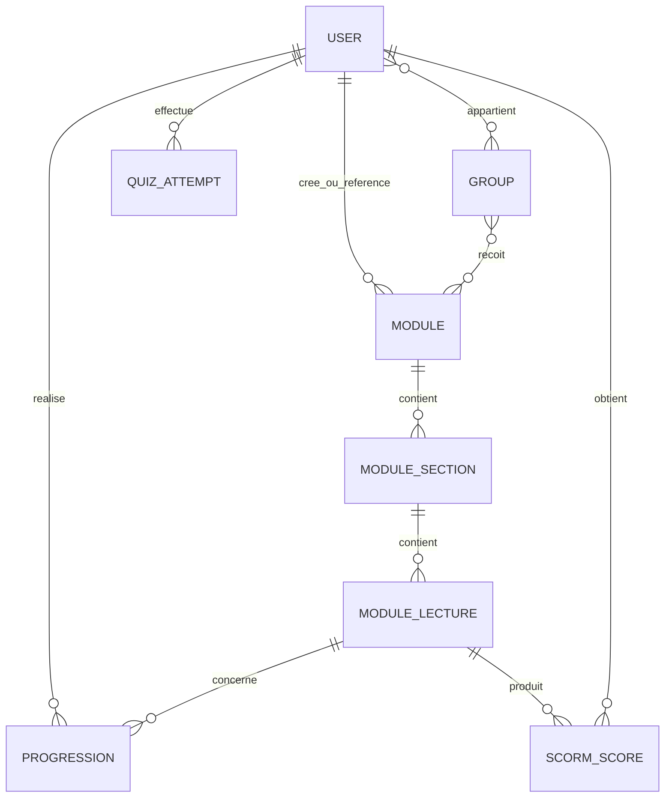

# 05 — Backend Schema (données et contrats serveur)

**But :** donner une vue métier stable du backend, au-delà du fichier SQL.\
**Sources de vérité d'exécution :** baseline `database/schema/mysql-schema.sql`, migrations, modèles, routes et code d'autorisation.

## Domaines de données

Ce diagramme est volontairement conceptuel. Il ne remplace ni les clés, ni les pivots, ni les migrations réelles.

## Entités centrales et invariants

| ID | Agrégat | Invariants à formaliser |
|---|---|---|
| `DATA-001` | Utilisateur | Rôle reconnu, statut contrôlé, accès et données personnelles séparés autant que possible |
| `DATA-002` | Groupe | Formateur principal valide ; membres et co-formateurs explicitement rattachés |
| `DATA-003` | Formation/module | Origine, propriétaire/référent, état et version ne sont pas interchangeables |
| `DATA-004` | Section/leçon | Ordre stable, appartenance unique attendue, type de contenu validé |
| `DATA-005` | Affectation groupe-module | Périmètre, position, version et visibilité déterminent l'accès effectif |
| `DATA-006` | Progression | Source, horodatage, règle de complétion et tentative doivent être explicables |
| `DATA-007` | Session d'outil live | Groupe, animateur, code, état d'ouverture et participants sont contrôlés serveur |

## Catalogue et versions

Une formation officielle partage une identité fonctionnelle entre versions. Un brouillon est modifiable ; une version publiée est immuable ; une version archivée peut rester nécessaire aux groupes déjà affectés. La publication et la bascule des groupes sont deux opérations distinctes. Les médias et contenus SCORM doivent suivre une règle de version compatible avec cette immuabilité.

## Autorisations à exprimer pour chaque ressource

| Opération | Questions obligatoires |
|---|---|
| Lire | Quel rôle ? Quel rattachement ? Ressource active/publiée ? Données minimales ? |
| Créer | Qui devient propriétaire ? Dans quel périmètre ? Avec quel journal ? |
| Modifier | Brouillon ou publié ? Propriétaire, co-formateur ou administrateur ? |
| Supprimer | Archivage, soft delete ou purge ? Quelles dépendances et preuves conserver ? |
| Exporter | Quel périmètre et quelles données personnelles ? Trace et durée de disponibilité ? |

## Contrat d'API ou d'action serveur

Chaque endpoint sensible doit documenter : méthode et route nommée, authentification, autorisation, entrée validée, réponse de succès, erreurs métier, idempotence, transaction, limitation de débit et effets de bord. Le contrôleur ne doit pas être considéré comme la seule documentation du contrat.

## Cycle de vie des données à compléter

| Catégorie | Création | Conservation | Export | Archivage/suppression | Responsable |
|---|---|---|---|---|---|
| Comptes et rattachements | À valider | À définir | À définir | À définir | À nommer |
| Progression et résultats | À valider | À définir | À définir | À définir | À nommer |
| Journaux techniques et métier | À valider | À définir | Selon finalité | Purge planifiée | À nommer |
| Médias et packages SCORM | Import/création | Selon version active | À préciser | Dépendances à contrôler | À nommer |
| Données des outils live | Pendant la séance | À définir | À préciser | À définir | À nommer |

## Processus de modification du schéma

1. Relier la modification à une exigence et une règle `DATA`.
2. Évaluer les données existantes, contraintes, index et volumes.
3. Prévoir une migration compatible avec le déploiement progressif (« expand/contract » si nécessaire).
4. Tester montée, compatibilité applicative et stratégie de restauration.
5. Mettre à jour ce document et les tests avant déploiement.

## Critère de sortie

Le schéma d'un lot est prêt lorsque les entités, relations, invariants, autorisations, contrats, migrations et règles de cycle de vie sont connus. Un diagramme seul n'est pas un Backend Schema exploitable.
